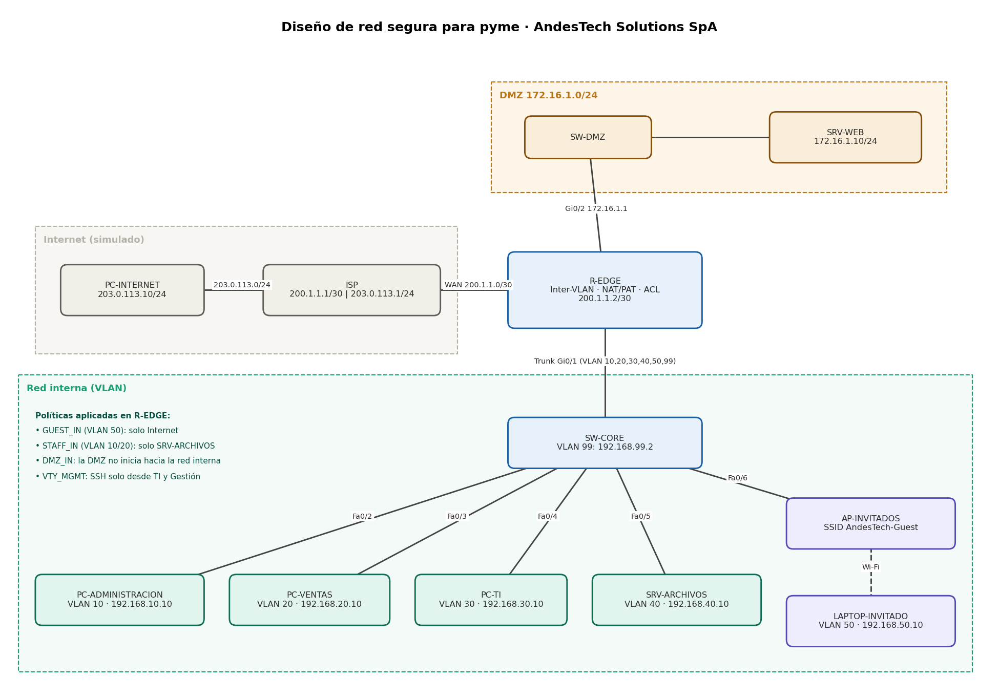

# Diseño de red segura para una pyme (AndesTech Solutions SpA)

Diseño, implementación y validación de una red corporativa segura para una pyme ficticia de ~40 usuarios, simulada en **Cisco Packet Tracer**. El proyecto incluye segmentación con VLAN, enrutamiento entre VLAN, zona DMZ, NAT/PAT, listas de control de acceso (ACL), Wi-Fi de invitados aislado y endurecimiento de la gestión (SSH).

> Todo el trabajo se realizó en un laboratorio simulado. Las contraseñas de los archivos de configuración fueron reemplazadas por `<password>`.

## Objetivo

Diseñar una red que cumpla estas políticas de seguridad:

1. Los **invitados** solo acceden a Internet, sin llegar a redes internas ni a la DMZ.
2. **Administración y Ventas** solo acceden al servidor de archivos, sin llegar a TI ni a Gestión.
3. **TI** administra todos los segmentos.
4. La **DMZ** publica el servidor web por el puerto 80 y no puede iniciar conexiones hacia la red interna.
5. La gestión de los equipos de red se hace solo por **SSH**, desde TI o la VLAN de Gestión.

## Topología



El diagrama editable está en [`diagrams/topology.drawio`](diagrams/topology.drawio) (se abre en [draw.io](https://app.diagrams.net)).

## Plan de direccionamiento

| VLAN | Nombre | Red | Gateway |
|---|---|---|---|
| 10 | Administración | 192.168.10.0/24 | 192.168.10.1 |
| 20 | Ventas | 192.168.20.0/24 | 192.168.20.1 |
| 30 | TI | 192.168.30.0/24 | 192.168.30.1 |
| 40 | Servidores internos | 192.168.40.0/24 | 192.168.40.1 |
| 50 | Invitados (Wi-Fi) | 192.168.50.0/24 | 192.168.50.1 |
| 99 | Gestión | 192.168.99.0/24 | 192.168.99.1 |
| — | DMZ | 172.16.1.0/24 | 172.16.1.1 |
| — | Enlace WAN (ISP ↔ R-EDGE) | 200.1.1.0/30 | R-EDGE .2 / ISP .1 |
| — | Internet simulado | 203.0.113.0/24 | 203.0.113.1 |

Detalle de IP por equipo en [`configs/hosts-ip.md`](configs/hosts-ip.md).

## Componentes

| Equipo | Función |
|---|---|
| **ISP** | Router que simula el proveedor de Internet |
| **R-EDGE** | Router de borde: inter-VLAN (router-on-a-stick), NAT/PAT, ACL y publicación del servidor web |
| **SW-CORE** | Switch principal con VLAN, trunk 802.1Q y puertos de acceso |
| **SW-DMZ** | Switch de la zona desmilitarizada |
| **AP-INVITADOS** | Access Point con SSID `AndesTech-Guest` (WPA2-PSK) en la VLAN 50 |
| **SRV-WEB / SRV-ARCHIVOS** | Servidor web público (DMZ) y servidor de archivos interno |

## Controles de seguridad implementados

### Segmentación y control de tráfico (ACL)

| ACL | Interfaz | Efecto |
|---|---|---|
| `GUEST_IN` | Gi0/1.50 (entrada) | Invitados: bloquea redes internas y DMZ; permite Internet |
| `STAFF_IN` | Gi0/1.10 y Gi0/1.20 (entrada) | Administración y Ventas: permite SRV-ARCHIVOS, DMZ e Internet; bloquea el resto de redes internas |
| `DMZ_IN` | Gi0/2 (entrada) | DMZ: solo respuestas hacia la red interna; bloquea conexiones iniciadas desde la DMZ |
| `VTY_MGMT` | Líneas VTY | Solo TI (192.168.30.0/24) y Gestión (192.168.99.0/24) pueden administrar por SSH |

### Endurecimiento de dispositivos

- SSH versión 2 con clave RSA de 1024 bits; Telnet deshabilitado (`transport input ssh`).
- `enable secret` y usuarios con hash; `service password-encryption` para el resto.
- Banner legal de acceso restringido.
- Puertos sin uso del switch apagados.
- NAT/PAT para la salida a Internet y NAT estático solo para el puerto 80 de la DMZ.

## Pruebas y resultados

| Prueba | Resultado esperado | Resultado |
|---|---|---|
| ADMINISTRACION → SRV-ARCHIVOS | Responde | ✅ |
| ADMINISTRACION → VENTAS / TI | Bloqueado (`Destination host unreachable`) | ✅ |
| ADMINISTRACION → DMZ / Internet | Responde | ✅ |
| TI → VENTAS / SRV-ARCHIVOS | Responde | ✅ |
| SRV-WEB → SRV-ARCHIVOS | Bloqueado | ✅ |
| PC-INTERNET → `http://200.1.1.2` | Carga la página del servidor web | ✅ |
| INVITADO → Internet | Responde | ✅ |
| INVITADO → SRV-ARCHIVOS / ADMINISTRACION / DMZ | Bloqueado | ✅ |
| SSH desde TI a R-EDGE y SW-CORE | Acceso con banner | ✅ |
| Telnet a R-EDGE | Sin sesión utilizable (conexión cerrada antes del login) | ✅ |
| SSH desde ADMINISTRACION a R-EDGE | Bloqueado (timeout) | ✅ |

Las capturas de cada prueba, con los contadores de las ACL, están en [`evidence/`](evidence/).

## Cómo reproducirlo

1. Abre `secure-sme-network-design.pkt` en Cisco Packet Tracer (o arma la topología según el diagrama).
2. Aplica las configuraciones de la carpeta [`configs/`](configs/) en cada equipo, reemplazando `<password>` por tus propias claves.
3. Genera la clave RSA en los equipos con `crypto key generate rsa` (1024 bits).
4. Configura las IP de los equipos finales según [`configs/hosts-ip.md`](configs/hosts-ip.md).
5. Configura el SSID `AndesTech-Guest` en el AP y conecta el laptop.
6. Ejecuta las pruebas de la tabla anterior.

## Limitaciones y mejoras futuras

- Las ACL extendidas **no guardan estado**; la palabra clave `established` solo revisa banderas TCP y puede ser eludida con paquetes manipulados. Mejora: un firewall con inspección de estado (Cisco ASA, Zone-Based Firewall o similar).
- Las contraseñas de línea usan cifrado tipo 7 (reversible) y los hash tipo 5 (MD5) son débiles. Mejora: tipos 8/9 y autenticación centralizada con AAA (RADIUS/TACACS+).
- Clave RSA de 1024 bits por limitaciones del simulador. En producción: 2048 bits o más.
- Direccionamiento estático. Mejora: DHCP por VLAN con DHCP snooping.
- Wi-Fi de invitados con clave compartida. Mejora: portal cautivo o WPA2/WPA3-Enterprise con RADIUS.
- Un solo router de borde y un solo switch central. Mejora: redundancia (HSRP, EtherChannel, enlaces dobles).
- Falta monitoreo centralizado. Mejora: Syslog y un SIEM (por ejemplo, Wazuh).

## Herramientas

Cisco Packet Tracer · draw.io · IOS (VLAN, 802.1Q, ACL, NAT/PAT, SSH)

## Estructura del repositorio

```
secure-sme-network-design/
├── README.md
├── secure-sme-network-design.pkt   (agregar el archivo de Packet Tracer)
├── configs/                        (configuraciones sin contraseñas)
├── diagrams/                       (topología en .drawio y .png)
└── evidence/                       (capturas de pruebas)
```

## Autor

Leonardo Suazo Fernandez
